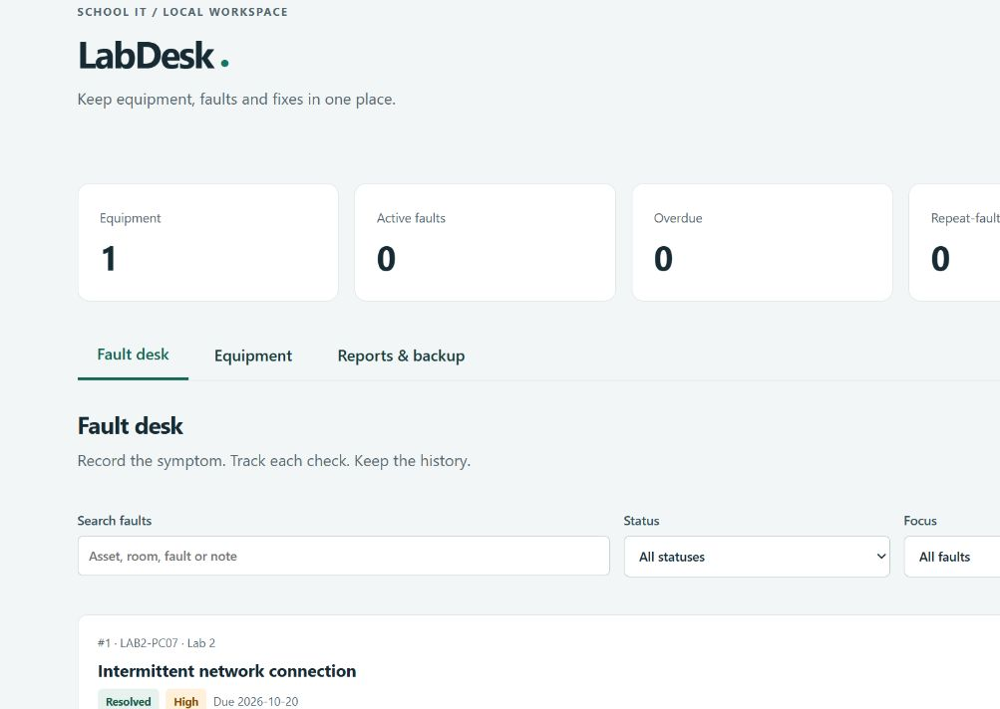

# LabDesk

**Equipment, faults and fixes — in one local workspace.**

LabDesk helps a school IT technician keep an equipment register, log faults and retain troubleshooting history. Runs on your computer with Python and SQLite. No account, API key, subscription or third-party Python package required.



## Start

Requires **Python 3.10+** and a modern browser. Download **Code → Download ZIP**, extract the ZIP, and open a terminal in the extracted folder containing `labdesk.py`.

```sh
python labdesk.py
```

Open **http://127.0.0.1:8768**. Keep the terminal running. Press **Ctrl+C** to stop. On Windows, use `py -3 labdesk.py` if `python` is not found; on macOS/Linux, try `python3 labdesk.py`.

There is no `pip install` or frontend build step. Once Python is installed and this repository is downloaded, the application works offline.

## How to use

1. Open **Equipment → Add equipment**. Enter an asset ID (`LAB2-PC07`), name, room and type. IDs are unique without case sensitivity and stored in uppercase. Use **Edit** to change the name, room, type or notes; the asset ID stays fixed so history remains linked.
2. Open **Fault desk → Log a fault**. Choose equipment, describe the fault, set priority and an optional due date, and record symptoms or initial checks.
3. Choose **View & update** on a fault. Add the check performed and its outcome; set **Open**, **In progress** or **Resolved**. Each update becomes a dated history entry. A resolved fault can be reopened.
4. Use search, status and focus filters to find work. Search includes asset ID, room, title and troubleshooting notes. **Overdue** means an unresolved fault whose due date is before today; due today is not overdue. **Repeat-fault assets** means equipment with at least two recorded faults, regardless of status, rather than a diagnosis that both have the same cause.
5. Open **Reports & backup** for a seven-day summary, printable report, CSV exports and full JSON backup.

To try fictional equipment, import [`examples/equipment.csv`](examples/equipment.csv) under **Reports & backup → Import equipment**. Re-importing existing IDs cancels the entire import, without partially adding records. The app starts empty; it never adds sample equipment automatically.

## Data, backups and recovery

- Records persist in **`data/labdesk.sqlite3`**, beside the app. They survive browser refreshes and app restarts. Browser storage is not used for records.
- Click **Full JSON backup** regularly. This includes equipment, faults and history. Keep a copy outside the application folder. Backups can contain your entered data; store them appropriately.
- To restore safely, stop the app and start with a **new database path**:

  ```sh
  python labdesk.py --db data/restored.sqlite3
  ```

  Open the app and select your JSON file under **Restore a backup**. Restore requires an empty database and validates references/history before committing. The original database remains at its old path. Restart with that path to return to it.
- For a file-level backup, stop the app first, then copy the SQLite file. Do not replace the file while the server is running.
- CSV equipment import columns must be exactly `id,name,room,kind,notes`, in that order. Use UTF-8; quote commas and multiline cells. Maximum 2,000 equipment rows per import. Fault CSV is a reporting export, not a fault importer.
- CSV exports neutralize cells beginning with spreadsheet formula characters using a leading apostrophe. Use JSON backup for exact recovery of entered text.
- Reports cover the last seven calendar dates including today. “Marked resolved” counts distinct faults with a resolution event during that period, even if subsequently reopened. Current backlog is all unresolved faults.

## Troubleshooting

| Problem | Fix |
| --- | --- |
| `python` not found | Install Python 3.10+ from python.org, then reopen your terminal; use `py -3` on Windows or `python3` on macOS/Linux. |
| Address already in use | Run `python labdesk.py --port 8769`, then open `http://127.0.0.1:8769`. |
| Cannot save / storage unavailable | Use a writable folder, check available disk space and check the database file permissions. Do not run two servers against the same database. |
| App refuses the address | Use the exact **127.0.0.1** URL printed in the terminal, rather than `localhost` or a LAN address. |
| Another tab changed the fault | Refresh and reopen that fault before adding your update. This prevents overwriting newer changes. |
| Restore says database is not empty | Start with a new `--db` path; existing records are intentionally protected. |
| Import fails | Check column order, required fields, valid UTF-8 and duplicate IDs. Correct the file and retry; failed imports add nothing. |
| Page stops saving after a restart | Refresh the page to obtain a fresh session token. |

## Scope and limits

This is a **single-user local application**, without login, encryption at rest or multi-user access controls. It binds only to `127.0.0.1` and checks request origin and session tokens. Keep it on your own computer; it is not designed for public hosting or LAN deployment. Anyone with access to your OS account or database file can access its records.

It records manual work. It does not scan a network, remotely control equipment, diagnose faults with AI, notify technicians or synchronize computers. No automatic deletion feature is provided. Due dates are calendar dates; creation/history timestamps are stored in UTC and displayed in browser local time. Keep OS/browser time settings consistent. No real school, staff or student records are included.

## Tests

From the project folder:

```sh
python -m unittest discover -s tests -v
```

Tests use temporary databases and cover persistence, history/status changes, stale updates, duplicate IDs, invalid dates/input, atomic CSV imports, exact backup restore, corrupt backup rollback, Unicode, CSV formula handling, HTTP save/export and request-origin protection. See [validation notes](docs/VALIDATION.md) for the verified environment and browser checks. Tests reduce risk; they are not a guarantee that every OS/browser combination is issue-free.

Release verification: **13 local tests passed**, including a clean extracted ZIP. GitHub Actions is currently blocked before execution by the owner's account billing lock; remote matrix results are unavailable.

## Project files

| Path | Purpose |
| --- | --- |
| `labdesk.py` | SQLite storage, validation, HTTP server and CLI |
| `web/` | Responsive browser interface; no external scripts/fonts |
| `examples/equipment.csv` | Fictional equipment to try |
| `tests/` | Automated store and HTTP integration tests |
| `data/` | Local records, ignored by Git |

Created for [Muhammad Ismail's portfolio](https://www.linkedin.com/in/muhammad-ismail-iqbal/). **MIT license.**
